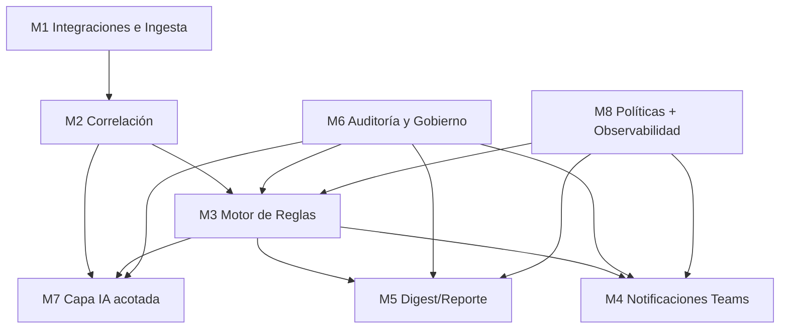

# Ororo — Módulos MVP v1 (análisis accionable para implementación)

## 1) Resumen ejecutivo

El estado documental de Ororo ya define con suficiente claridad **qué construir** para un MVP útil: ingesta de eventos Jira/GitLab, correlación operativa, reglas de riesgo, notificaciones accionables en Teams, y gobierno (auditoría/políticas).  
La recomendación es ejecutar el MVP en módulos desacoplados, con foco en **valor temprano + control de ruido + trazabilidad**.

Prioridad real para salir a producción piloto:
1. Integraciones + Ingesta normalizada
2. Correlación Jira↔GitLab
3. Motor de reglas y priorización
4. Notificaciones y acciones rápidas en Teams
5. Digest pre-daily
6. Auditoría y gobierno
7. IA acotada para resúmenes/clasificación
8. Panel de configuración y observabilidad

---

## 2) Lista de módulos MVP (priorizados)

1. **M1. Integraciones e Ingesta de Eventos (GitLab/Jira/Teams)**
2. **M2. Correlación Operacional (ticket ↔ MR ↔ pipeline)**
3. **M3. Motor de Reglas y Priorización (P0–P3 + dedupe + escalado)**
4. **M4. Notificaciones y Acciones en Teams**
5. **M5. Digest Pre-daily y Reporte Semanal Básico**
6. **M6. Auditoría, Aprobaciones y Gobierno**
7. **M7. Capa IA acotada (resumen MR + clasificación bloqueos)**
8. **M8. Configuración de Políticas + Observabilidad Operativa**

---

## 3) Detalle por módulo

## M1. Integraciones e Ingesta de Eventos
- **Propósito:** recibir señales confiables desde Jira/GitLab/Teams y normalizarlas para el core.
- **Alcance funcional:**
  - Webhooks/polling incremental.
  - Validación de firma/autenticidad.
  - Persistencia en `events_raw` + normalización en `events_normalized`.
  - Dedupe por `external_event_id + provider`.
- **Entradas/Salidas:**
  - Entrada: payloads externos (MR, pipeline, cambios de issue, callbacks Teams).
  - Salida: eventos normalizados listos para reglas.
- **Dependencias:** infraestructura de colas (Redis), modelo de datos base.
- **Riesgos:** spoofing, picos de eventos, cambios de API.
- **Criterios de aceptación:**
  - Firma inválida rechazada y auditada.
  - Sin duplicados funcionales ante reintentos.
  - p95 ingestión raw <300ms y normalización p95 <5s.

## M2. Correlación Operacional
- **Propósito:** construir contexto único por entidad operativa del sprint.
- **Alcance funcional:**
  - Linking automático issue key en branch/commit/MR.
  - Gestión de conflictos (múltiples issues por MR).
  - Score de confianza + fallback manual.
- **Entradas/Salidas:**
  - Entrada: `events_normalized`, `work_items`, `merge_requests`, `pipelines`.
  - Salida: relaciones en `work_item_links` y contexto para reglas.
- **Dependencias:** M1.
- **Riesgos:** correlaciones erróneas por convención inconsistente.
- **Criterios de aceptación:**
  - Tasa de correlación válida sobre umbral acordado (definir en kickoff).
  - Casos ambiguos marcados con baja confianza, no automatizados.

## M3. Motor de Reglas y Priorización
- **Propósito:** decidir qué alertar, a quién y cuándo con lógica determinista.
- **Alcance funcional:**
  - Reglas de ticket estancado, pipeline crítica, MR sin revisión.
  - Prioridad P0–P3.
  - Supresión/ventanas anti-spam y dedupe temporal.
- **Entradas/Salidas:**
  - Entrada: contexto de M2 + políticas.
  - Salida: `alerts` con severidad, destino y acción sugerida.
- **Dependencias:** M2, M8 (políticas).
- **Riesgos:** umbrales mal calibrados (ruido o silencio).
- **Criterios de aceptación:**
  - Cada evaluación registra regla + inputs + resultado.
  - Reducción progresiva de tickets >72h y mejor reacción a pipelines críticas.

## M4. Notificaciones y Acciones en Teams
- **Propósito:** convertir alertas en acciones rápidas con baja fricción.
- **Alcance funcional:**
  - Mensajes estructurados por criticidad.
  - Botones: actualizar, postergar, escalar, marcar bloqueado.
  - Routing por canal/rol.
- **Entradas/Salidas:**
  - Entrada: `alerts` y templates.
  - Salida: `notifications`, callbacks de acción y confirmaciones.
- **Dependencias:** M3, M6 (auditoría).
- **Riesgos:** fatiga de alertas y destino incorrecto.
- **Criterios de aceptación:**
  - Mensajes críticos en canal correcto según matriz.
  - Callbacks procesados y trazados end-to-end.
  - Ratio útil/ruido inicial ≥70% tras 3 sprints de piloto (objetivo del doc base).

## M5. Digest Pre-daily y Reporte Semanal Básico
- **Propósito:** dar visión accionable de sprint sin trabajo manual de consolidación.
- **Alcance funcional:**
  - Job diario pre-daily por squad.
  - Job semanal de estado operativo.
  - Bloques cortos con top riesgos y recomendación.
- **Entradas/Salidas:**
  - Entrada: alerts, estado de work_items/MR/pipelines, feedback.
  - Salida: `digests` + notificación Teams.
- **Dependencias:** M3, M4.
- **Riesgos:** digest largo o con datos parciales no marcados.
- **Criterios de aceptación:**
  - Entrega antes de daily >95% días hábiles.
  - Contenido accionable con enlaces directos.

## M6. Auditoría, Aprobaciones y Gobierno
- **Propósito:** garantizar confianza, reversibilidad y cumplimiento.
- **Alcance funcional:**
  - `audit_logs` por evento→regla→acción.
  - `approvals` para acciones sensibles.
  - Kill switch por automatización/squad.
- **Entradas/Salidas:**
  - Entrada: acciones de M3/M4/M5/M7.
  - Salida: evidencia auditable y controles de gobierno.
- **Dependencias:** transversal (afecta todos).
- **Riesgos:** falta de evidencia en incidentes.
- **Criterios de aceptación:**
  - Reconstrucción completa de incidentes críticos por `correlation_id`.
  - Cambios de políticas con actor/motivo/versionado.

## M7. Capa IA Acotada
- **Propósito:** mejorar legibilidad de salidas (no decidir operaciones críticas).
- **Alcance funcional:**
  - Resumen de MR.
  - Clasificación básica de bloqueos.
  - Guardrails + esquema de salida + fallback determinista.
- **Entradas/Salidas:**
  - Entrada: contexto técnico/operativo + templates.
  - Salida: texto enriquecido validado.
- **Dependencias:** M2, M3, M6.
- **Riesgos:** alucinaciones/imprecisión.
- **Criterios de aceptación:**
  - Sin invención de IDs/estados/responsables.
  - Si falla validación, usa plantilla determinista automáticamente.

## M8. Configuración de Políticas + Observabilidad
- **Propósito:** ajustar comportamiento sin redeploy y operar con métricas.
- **Alcance funcional:**
  - CRUD limitado de políticas (umbrales, silencios, frecuencia).
  - Feature flags por módulo/squad.
  - Dashboard mínimo de latencia, error rate, backlog cola, útil/ruido.
- **Entradas/Salidas:**
  - Entrada: configuración de admin, métricas/logs.
  - Salida: políticas activas y visibilidad operativa.
- **Dependencias:** M6.
- **Riesgos:** cambios peligrosos sin validación.
- **Criterios de aceptación:**
  - Cambios efectivos sin deploy + auditados.
  - Alertas internas por degradación operativa.

---

## 4) Mapa de dependencias entre módulos

Lectura práctica:
- **Cadena crítica MVP:** M1 → M2 → M3 → M4/M5.
- **M6 y M8** deben entrar temprano para evitar deuda de control.
- **M7 (IA)** no bloquea el arranque: se integra cuando ya existe salida determinista.

---

## 5) Orden de implementación en fases (PR por PR)

### Fase 0 — Bootstrap técnico y seguridad
- **PR-001:** Esqueleto módulos + migraciones base (`workspaces`, `integrations`, `people`, `projects`, `sprints`).
- **PR-002:** Observabilidad mínima (logs estructurados + correlation_id + health endpoints).
- **PR-003:** Gestión de secretos y validación de firmas webhook.

### Fase 1 — Flujo mínimo de valor (M1+M2)
- **PR-004:** Ingesta GitLab (`events_raw`, cola, normalización base).
- **PR-005:** Lectura Jira + normalización de issues clave.
- **PR-006:** Correlación ticket↔MR↔pipeline (`work_item_links`, confidence_score).

### Fase 2 — Decisión y salida operativa (M3+M4)
- **PR-007:** Motor de reglas v1 (estancamiento + pipeline crítica + dedupe).
- **PR-008:** Integración Teams (plantillas iniciales, routing por prioridad).
- **PR-009:** Acciones rápidas básicas (postergar/escalar/actualizar) con callback.

### Fase 3 — Valor de coordinación diaria (M5)
- **PR-010:** Scheduler y generación de digest pre-daily.
- **PR-011:** Reporte semanal operativo básico + distribución.

### Fase 4 — Gobierno y control operativo (M6+M8)
- **PR-012:** Auditoría completa (`audit_logs`, `policy_versions`).
- **PR-013:** Aprobaciones y kill switch de automatizaciones.
- **PR-014:** Panel de políticas MVP + feature flags + métricas útil/ruido.

### Fase 5 — IA acotada y endurecimiento (M7)
- **PR-015:** Resumen de MR con validación de esquema + fallback.
- **PR-016:** Clasificación de bloqueos (baja autonomía) + evaluación inicial de calidad.
- **PR-017:** Hardening final: tuning anti-ruido, pruebas de carga, checklist Go/No-Go.

---

## 6) Qué NO entra en el MVP

1. Predicción avanzada de cumplimiento de sprint con modelos complejos.
2. Reasignación automática de tareas sin aprobación humana.
3. Cierre/transición masiva autónoma de issues.
4. BI ejecutiva avanzada/multifuente.
5. Automatizaciones transversales fuera de Jira-GitLab-Teams.
6. Motor autónomo sin guardrails y sin trazabilidad.
7. Personalización profunda por equipo desde día 1 (solo políticas básicas).
8. Integración con evaluación de desempeño individual.

---

## Cierre operativo recomendado

- Arrancar piloto con **1 squad** durante 2–3 sprints.
- Definir baseline previo para 4 KPIs: estancamiento, primera revisión MR, MTTR pipeline crítica, útil/ruido.
- Gate de continuidad al cierre de piloto: escalar solo si mejora KPI + estabilidad + adopción.
